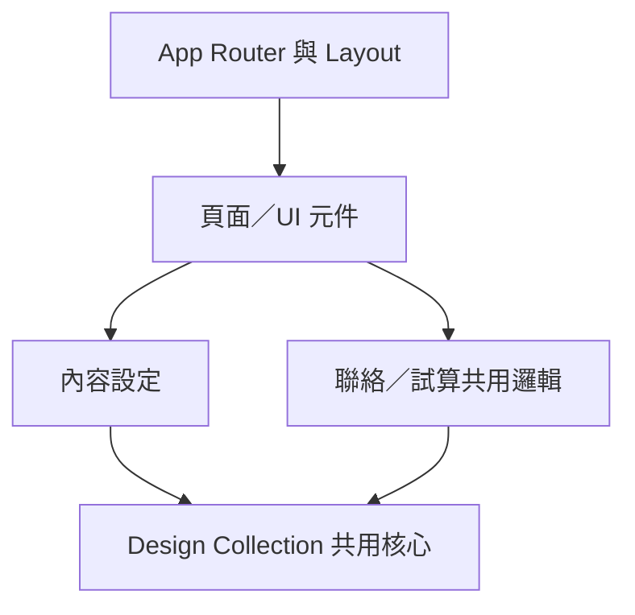

# 官網技術架構與工程入口

本文件整理已存在的程式與工程文件，核對基準：2026-11-26，main `90cee00534bf30c9820cd314746880ff95b625a8`。不新增架構決策或開發需求。版本以 [package.json](../../package.json)／[package-lock.json](../../package-lock.json) 為準，公司層級規範見 [XK SYSTEM 文件](https://github.com/xk2022/xplore-kaleidoscope)。

## 現行架構

| 層級 | 實際來源與職責 |
| --- | --- |
| 網頁與 Layout | [src/app](../../src/app) — Next.js App Router、Metadata、現行 Modern Layout |
| 呈現與共用元件 | [src/components](../../src/components) — brand、layout、sections、ui 與 dev |
| 內容設定 | [src/config](../../src/config) — 品牌、服務、作品、聯絡、試算與 SEO 的單一來源 |
| 共用邏輯 | [src/lib](../../src/lib) — SEO、聯絡草稿、試算及三風格核心 |
| 靜態素材 | [public](../../public) — 品牌、圖示、案例、試算 QR |
| 品質工具 | [scripts](../../scripts)、[fixtures](../../scripts/fixtures) — 測試、靜態匯出與 HTTP 驗收 |
| 發布 | [CI workflow](../../.github/workflows/ci.yml) — PR 品質與 Pages artifact、main 自動部署 |
| 文件 | [docs](../README.md) — 規格、設計、驗收證據及歷史 |

Next.js 16.4.6、React 19.3.1、TypeScript 5、Tailwind CSS 4.3.3、shadcn/ui／Lucide、Node.js 24.x。現行是獨立前端官網，未引入 Backend、資料庫、CMS。

DC-002 核心已建立但尚未接入既有頁面的新呈現層；圖中的核心依賴共用來源，不代表現行頁面已使用三系列容器。

## 三風格架構對照

| 項目 | 現況 | 權威來源 |
| --- | --- | --- |
| Modern 16 頁 | 現行根路徑、既有 Layout | [根 README](../../README.md)、[核心契約](design-collection-core.md) |
| Gallery、Heritage、Luxury | 規劃中，未輸出新路由 | [架構規格](../01_design/design-collection/architecture.md) |
| 共用內容及路由 | DC-002 已合併 | [registry](../../src/config/design-collection.ts)、[核心模組](../../src/lib/design-collection) |
| 各系列 Token／版面 | 契約已定義；視覺實作及核准待後續 | [設計索引](../01_design/README.md) |
| 聯絡與試算 | 既有本機草稿及參考計算；無站內收件 | [核心 API](design-collection-core.md)、[回覆流程](../02_operations/contact-response-workflow.md) |

三風格完成目標是 49 頁（16 × 3 + Gallery），不是現在的頁數。實作順序及各階段驗收依 [DC 工作包](../01_design/design-collection/work-packages.md)，不得把規劃回傳值當公開連結。

## 工程文件索引

| 需求 | 入口 |
| --- | --- |
| 快速啟動、版本、建置 | [根 README](../../README.md) |
| 協作、分支、驗收 | [AGENTS](../../AGENTS.md)、[協作流程](subagent-workflow.md) |
| 共用核心 API、狀態與隔離 | [Design Collection 核心](design-collection-core.md) |
| 本機／Pages HTTP 回歸 | [Smoke](website-smoke.md) |
| 效能測量 | [量測指南](performance-measurement.md) |
| 正式網址及發布門檻 | [網域](../04_deployment/custom-domain-deployment.md)、[SEO](../04_deployment/seo-operations.md)、[發布清單](../04_deployment/publication-readiness.md) |
| 工作包及驗收證據 | [任務索引](../task/README.md)、[報告索引](../reports/README.md) |

## DOC-004 整理範圍

核對現有 Git tree、manifest、DC-001 規格與 DC-002 核心使用契約；集中入口並引用既有詳文。原始設計規格、資料、頁面、驗收報告、依賴與部署設定均未變更。
