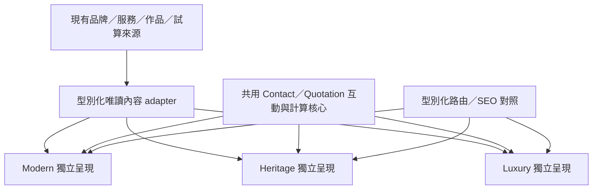

# XK Design Collection — 架構規格

版本：DC-001 / v1.0。日期：2026-11-26。狀態：**架構提案，等待 PR 審閱；尚未實作或授權發布新系列**。

本文件與 [三套 Design System](design-systems.md)、[DC-001～DC-007 工作包](work-packages.md) 構成同一份規格。當次交付範圍見 [DC-001 任務](../task/dc001.md)，實際檢查見 [驗證紀錄](../reports/dc001-architecture.md)。

## 1. 基準與來源

- Website：`xk2022/xk-website`，最新 main `8d7d97d33e4b6ee45f32cc75953c0e008c9951d7`；初始乾淨。PR #28 已合併試算功能，舊 README／報告的待審段落是當時快照，不代表目前未實作。
- 公司文件：唯讀最新 main `5be640ab11811b24706101ea13db73185e9ce4d8`，tree `10895f056504089267a9661c3685b7ff2d8ff1d8`。本輪重新核對 main，品牌文件補讀全文；其他同版已讀來源沿用版本紀錄。
- 公司根 `AGENTS.md` 缺失：相同完整 tree 無同名檔案，前次根路徑為 404。本輪以現存正式文件及 Website AGENTS／workflow 執行，不在文件 Repository 補檔。
- 現行 Next.js 16.4.6、React 19.3.1、TypeScript 5、Tailwind CSS 4.3.3、shadcn/ui、Lucide React、Node.js 24；不重新初始化或切換框架。
- 公司正式文件及相關關鍵詞查詢未找到 Design Collection／Modern／Heritage／Luxury 的既定規範。本輪的系列、版型及新增色彩是設計提案，不能稱為公司已批准的新識別。

固定版本來源如下；表內路徑均在公司 Repository，不是本專案的新檔案。

| 文件 | Blob SHA | 本規格採用 |
| --- | --- | --- |
| `doc/03_brand/README.md` | `ad60667527239356db541becefe823fe754304a6` | 官網、作品集外框與署名遵循品牌；個案主視覺依範圍設計 |
| `doc/03_brand/品牌識別.md` | `5457641828bfe448a4fcf0018fa616003879062d` | 同一公司識別，不創造三個品牌或法定實體 |
| `doc/03_brand/品牌色票與介面用途.md` | `c8d5746b8d1f146f51893ce092429c1ae4c009c5` | 正式品牌角色與對比要求 |
| `doc/03_brand/字體與排版.md` | `ea2a6799641f9a0089eef0d349088b9f1cb8c833` | Inter／Noto Sans TC 與繁中可讀性 |
| `doc/03_brand/logo-guidelines.md` | `4f5f405f991e24984b1d8f0582ef72074359ed90` | 正式 Logo 03 與核定反白版本，不重畫染色 |
| `doc/02_services/README.md` | `f15c71d7901946a9ba28048c3ef0260e337a0e2f` | 真實服務能力及規劃狀態 |
| `doc/02_services/網站建置方案.md` | `02a2685b81f23988fe49d6d0ea03f71fd8c40c43` | 方案範圍與交付，不按風格自行加價 |
| `doc/02_services/定價策略.md` | `59fea2a9d9805bbbfa7407a01ce5ce275a737a77` | 參考、面議、第三方與維護費界線 |
| `doc/04_engineering/website-repository-naming.md` | `2e3488d10194bb12c151c9e7eb16a722f015a2c5` | LP／BRAND／CORP／SHOP／APP 與呈現風格分開 |
| `doc/04_engineering/development-workflow.md` | `551a5c5fd45f25f480351b036545c1c022678973` | 分支、PR、當次授權與可追溯交付 |
| `doc/04_engineering/testing-and-release.md` | `044cc3bda0195f88abafd4d43dcf9801cf9b67f3` | 純文件檢查及 Pages 第一階段部署 |
| `doc/04_engineering/architecture.md` | `6149c6c5efaf169aa5ea2c8551f08379f5509457` | 公開內容採 Next.js 靜態匯出；本機摘要與正式收件分開 |
| `doc/05_projects/official-website/README.md` | `cf34ae02e039357ebef6048525f8944ec2520d4b` | 路徑及發布狀態以實作庫為準 |

[公司固定版本 Tree](https://github.com/xk2022/xplore-kaleidoscope/tree/5be640ab11811b24706101ea13db73185e9ce4d8)。已安裝 Next.js 文件依據為 `01-app/03-api-reference/03-file-conventions/route-groups.md`、`01-app/02-guides/static-exports.md`、`01-app/01-getting-started/11-css.md`，位於 `node_modules/next/dist/docs/`。

## 2. 目標、邊界與決策

三系列是同一份品牌內容的三套網站呈現：Modern 現代專業、Heritage 懷舊復古、Luxury 奢華精品。它們不是價格級距、公司年資、不同客戶案例或不同服務能力。Heritage 不暗示歷史傳承；Luxury 不暗示高端客戶、品質保證或額外成果。

| 決策 | 方案與理由 |
| --- | --- |
| 單一 Repository／應用／網域 | 共用來源及計算，降低內容分歧；不建立三個部署或子網域 |
| Modern 原網址 | 保留全部 16 個已公開頁面、原錨點與行為；不另建 `/modern` 別名 |
| 新系列獨立 namespace | `/design-collection/heritage/`、`/design-collection/luxury/`，可直接分享與重新整理 |
| 獨立頁面編排 | 三個 shell 與三組 section composition；共用語意元件／互動核心，不複製業務資料 |
| 技術根 layout 共用 | 保留語言、字體載入、品牌 Metadata 及唯一 WebSite JSON-LD；不以 client pathname 決定主題 |
| 風格由 URL 決定 | 不做 hydration 後換色、cookie／LocalStorage 風格偏好、地區或裝置導向 |
| SEO 以 Modern 為內容主版本 | 同內容的展示版 canonical 對應 Modern；分享 URL 保留所選系列；保護模式不變 |
| 本輪文件限定 | 不新增路由、資產、token、程式、依賴、DNS、workflow 或正式首頁修改 |

**品牌差異處理：**現行 Modern 全站保留初始色票，試算頁另有正式色票範圍；本次不把新公司色票回灌全站。新系列的品牌署名、Logo 與公司身分使用正式來源；展示主體的紙感、深色、金色等新增設計角色必須標為提案，經 DC-004／DC-005 品牌審閱後才可實作公開版本，不能自行宣稱公司規範已有此例外。

## 3. 現況與共用內容邊界

目前公開內容共 16 頁：七個主頁（首頁、About、Services、Solutions、Portfolio、Contact、Quotation）、三個技術作品詳頁、六個品牌展示詳頁。技術作品仍依 registry 標示 Planned，展示網站與第三方模板各自保留性質、排序、署名及素材限制。

| 資料／行為 | 現有權威來源 | 三系列契約 |
| --- | --- | --- |
| 公司、標語、網域 | `src/config/site.ts`、`about.ts` | 同一公司資訊與正式文案，不在主題中改寫事實 |
| 首頁與服務 | `homepage.ts`、`services.ts`、`service-plans.ts` | 保留 Home Maintenance 與詳細服務分類的既有對照，不把產品碼、服務碼與風格混為一談 |
| 解決方案 | `solutions.ts`、`solution-showcases.ts` | 共用方向、狀態、ServiceId 與有效錨點 |
| 作品 | `portfolio.ts`、`website-showcases.ts` | 共用案例 ID、內容、媒體、順序與可公開連結，不把三種呈現算作三個客戶成果 |
| 聯絡 | `contact.ts`、`contact-page.ts`、`inquiry.ts`、`contact-inquiry.ts` | 唯一商務 Email；四欄本機草稿、複製與 mailto 界線一致 |
| 試算 | `quotation.ts`、`src/lib/quotation/` | 同一 range／from／quote、相容矩陣、費用週期、來源及摘要邏輯，風格不得加價 |
| SEO／發布 | `seo.ts`、`deployment.ts`、`privacy.ts` | 不由主題另設網域、索引、法律核准或發布規則 |

表中的簡名均位於 `src/config/`。新增唯讀內容 adapter 只整理既有資料形狀，不複製原文、篡改順序或另建價格。發現既有來源間不一致時，列入問題與證據，由對應內容任務處理；不可在某主題默默修成另一組商業事實。



允許共用 shadcn／Lucide、表單驗證、focus 管理、計算與儲存、資料型別、A4 企業摘要；版面、section 順序、導覽樣式、卡片 recipe 與圖片編排由各系列負責。不得以一份 Modern 頁面加 theme class 冒充三套獨立版型。

## 4. 路由與階段清冊

下表都是**未來規劃**，本次不把新 URL 加進現行導覽或 SEO registry。斜線顯示 Pages 直達網址；一般 Next.js 依現有設定服務。

| Page key | Modern | Heritage／Luxury 各自對應 |
| --- | --- | --- |
| home | `/` | `/design-collection/{style}/` |
| about | `/about/` | `/design-collection/{style}/about/` |
| services | `/services/` | `/design-collection/{style}/services/` |
| solutions | `/solutions/` | `/design-collection/{style}/solutions/` |
| portfolio | `/portfolio/` | `/design-collection/{style}/portfolio/` |
| technical-project | `/portfolio/{slug}/`，三個已知 slug | 同前綴加三個相同 slug |
| brand-showcase | `/portfolio/showcases/{slug}/`，六個已知 slug | 同前綴加六個相同 slug |
| contact | `/contact/` | `/design-collection/{style}/contact/` |
| quotation | `/quotation/` | `/design-collection/{style}/quotation/` |
| collection | 不屬某系列：`/design-collection/` | 三系列比較與完整路徑目錄 |

`{style}` 僅允許 `heritage`、`luxury`；Modern 的 style ID 雖為 `modern`，URL resolver 回傳原路徑。`/design-collection/modern/` 不建立第二份 Modern；未知 style／slug、各風格 `/privacy`、未實作服務詳頁及 API 路徑回傳真正 404，不導向首頁或產生假頁。

| 階段 | Modern | Gallery | Heritage | Luxury | 公開 HTML 頁數（不含 404） |
| --- | --- | --- | --- | --- | --- |
| 現況／DC-001／DC-002 | 16 | 0 | 0 | 0 | 16 |
| DC-003 完成並經發布授權後 | 16 | 1 | 0 | 0 | 17 |
| DC-004 完成並經發布授權後 | 16 | 1 | 16 | 0 | 33 |
| DC-005～DC-007 完整目標 | 16 | 1 | 16 | 16 | 49 |

每階段以獨立核定 fixture、SEO registry、輸出 HTML 三方比對精確清冊；不能從渲染實作反產生全部期望，或忽略整個 collection namespace。未完成卡片顯示文字「規劃中」，沒有假連結。頁數是本輪完整同資訊架構的提案範圍，不表示現在已存在 49 頁。

## 5. Next.js 組織與搬移

目前 `src/app/layout.tsx` 直接包含 skip link、Header、main、Footer；直接套新巢狀 layout 會出現雙 Header 與雙 main。DC-003 才進行以下結構調整，本次不搬檔：

```text
src/app/
  layout.tsx                         共用 html/body、字體、Metadata、JSON-LD
  globals.css                        保留 Modern 全域定義
  icon.svg / robots.ts               保留原對外網址及保護規則
  not-found.tsx                      規劃：未知全域路徑的完整 Modern 404 frame
  (modern)/
    layout.tsx                       原 skip/Header/main/Footer，fragment 不加 wrapper
    not-found.tsx                    規劃：frame 內的 404 內容
    page.tsx / about/ / services/ / solutions/
    portfolio/ / contact/ / quotation/ / privacy/ / dev/
  (collection)/design-collection/
    page.tsx                         Gallery，使用正式品牌 shell
    [style]/
      layout.tsx                     server 端選 HeritageFrame 或 LuxuryFrame
      not-found.tsx                  規劃：系列 frame 內 404 內容
      page.tsx / about/ / services/ / solutions/
      portfolio/ / contact/ / quotation/
src/design-systems/
  modern/                            既有 token／recipe 的相容 facade
  heritage/                          獨立 token／recipe／layout 契約
  luxury/                            獨立 token／recipe／layout 契約
src/components/design-collection/
  modern/ / heritage/ / luxury/       各自 shell 與 section composition
  shared/                            Gallery、Switcher、內容與行為共用元件
src/config/design-collection.ts       規劃中的 style／route 狀態 registry
src/lib/design-collection/            規劃中的 href、metadata、內容 adapter
```

以上未存在的檔案都標為規劃，沒有要求本輪建立。Route group 括號不屬 URL。搬移舊 route 時必須一次移除原 page 位置，不保留兩份相同 URL；Portfolio 兩組動態 slug、Privacy／dev gate 與 build guard 內 source path 必須同步調整。

維持一個技術 root layout；三個 frame 各提供且只提供一份 skip link、banner、main 與 Footer。Modern fragment 保持原 DOM 順序及既有畫面；原 metadata／字體／JSON-LD 不因 route group 被重複輸出。全域未知路徑及已知頁內 notFound 的 frame 行為需用普通／Pages 實際 HTML 確認，禁止雙重包覆；若原生全域 404 與 group 404 行為不同，先修正分工，不引入未驗證的 experimental flag。

`[style]` 在建置時只列出當階段完成且核定的兩個新 style ID 子集，設定 `dynamicParams = false`。三／六個作品 slug 使用各自 static params，產生 style × slug 的完整已知組合。Next.js 16 的 params 依已安裝文件使用 Promise；不可讀 cookies、headers 或瀏覽器 pathname 才決定 SSR 呈現。不用 middleware／Proxy、rewrite、執行期 redirect、catch-all 假首頁或三份真正 root layouts。

## 6. 風格切換與個資

- `resolveDesignHref` 以 style ID、page key、經 registry 核准的 slug 與 anchor 決定 URL；名稱是規劃 API，不是已存在 export。所有 Header、Footer、服務／作品／詢價 CTA 用同一份對照，不能到處拼接字串。
- 外部案例、來源署名、mailto 等目的地不加系列前綴；只有同 origin 且屬已知公開 page key 的站內目的地可轉換。共享資料中的原 href 保留，由 adapter 明確解析成邏輯目的地，不能任意改寫未知 URL。
- 同頁可用時保留內容位置；只在對應頁宣告同名語意 anchor 時保留 hash。沒有對應頁時，明標「查看 Heritage 首頁（此頁尚未提供該風格）」，或呈現不可操作文字，不默默丟到另一頁。
- Switcher 用真實連結與目前風格標示，不把風格當語言，不新增 hreflang；不得靠 hover、顏色或無標籤圖示辨認。普通／停用／目前項目、focus、返回／前進與新分頁直達都要測。
- URL 是唯一風格來源。不要以自動記憶偏好覆蓋分享網址；不用 query、cookie、LocalStorage 儲存風格或表單內容。
- Contact 草稿及試算個人欄位仍只留當頁記憶體。換風格須以 style＋page key 明確重設個人 state，先提供可見提示；不先自動複製或把個人資料帶進 URL。
- `xk:quotation:v1` 的方案 ID 保存仍共用，reload／換系列可以還原選項；稱呼／專案名不保存。重設只刪自己的 key，不能清除其他站點資料。
- 三套 Contact 共享驗證／複製／長 mailto fallback，三套 Quotation 共享計算／清洗／儲存／摘要；各自獨立安排畫面。A4 企業摘要共用同一份標準版，不把風格變成正式報價單。

## 7. SEO、Canonical 與分享

| 路由類型 | Canonical | Open Graph URL | 索引／Sitemap |
| --- | --- | --- | --- |
| 既有 Modern 16 頁 | 原 www 同頁 URL，原輸出不變 | 原同頁 URL | noindex/nofollow；Sitemap 404 |
| Collection Gallery | www `/design-collection/` | 同 Gallery URL | 相同保護 |
| Heritage／Luxury 對應頁 | 同內容 Modern 對應 URL | 實際系列 URL，分享仍能打開指定風格 | 相同保護 |
| 未完成、Privacy 草案、dev、錯誤路徑 | 不建立公開對應頁 | 不製造分享／作品入口 | 維持排除／404 |

所有網址使用 `siteConfig.url` 與 `pagesDeployment` 的 www 契約，不用 request host、舊 GitHub repo 前綴或新子網域。Canonical 與 OG 的展示版差異是本規格的明確決策：前者合併同內容主版本，後者保留分享體驗，不能套用目前「兩者永遠相同」的驗證假設。未來 typed metadata adapter 必須分開 `canonicalPath` 與 `presentationPath`；Modern 現有 helper 輸出及保護規則不得改變。

系列 Title／Description 可加「Heritage 設計展示」等呈現資訊，服務與公司事實保持相同。不為三種風格建立三個 Organization／Review／Product 承諾；每份 HTML 仍只有一次同一個 WebSite JSON-LD。沒有已核准 OG 圖時沿用目前無圖與 text-only Twitter summary，不把網站截圖自動升為批准分享素材。未來正式索引仍是獨立 Owner 決策，不因 DC-007 技術 PASS 自動啟用。

## 8. CSS、互動、資產與部署

現有 Turbopack `*.css` loader 涵蓋 CSS Module；前輪已改用 plain quotation.css。新系列採明確的 Heritage／Luxury namespace 及完整語意 token override，不能假設 module exports 已可用，也不能修改全域 `:root` 來切換。共用 shadcn 行為，recipe 及版面獨立；portal 若存在，掛載容器須在正確系列範圍。不把三套商業資料複製到 theme folder。

Next.js global CSS 在 client navigation 後可能仍存在：需測 Modern → Heritage → Luxury → Modern、返回／前進、深頁直達及冷載入，檢查無樣式殘留與閃爍。Quotation 目前裸 `@page` 是跨頁列印風險，**本輪未重現故障**；DC-002／DC-006 須規劃具名 page 或等效隔離並重驗 Quotation → 其他風格 → Modern 後列印，不可用裁切／縮放假造單頁。

共用來源 Logo、案例圖片及 QR，不按風格複製相同檔案或染色原圖。新裝飾／字體須有來源、授權、檔案預算與審閱紀錄。保留 Next.js 一般 build；Pages 使用 output export、空 basePath／assetPrefix、trailingSlash 與 unoptimized images。資產使用既有 root URL 契約，深層路徑不得產生相對圖片 404。

CI 仍只從已授權 main 發布，PR 只檢查及產出 artifact。本輪不改 workflow、Pages Source、DNS、Custom Domain、Vercel／Render 資源或任何後端；APP 免費 DEMO 託管規範不適用於切換本官網。

## 9. 主要風險與審閱事項

1. 新 palette、材質、額外字體及展示外框的適用例外尚待品牌審閱；正式 Logo／公司事實不在例外內。
2. 完整目標為三份同資訊架構共 49 頁；這是本輪提案的範圍，須隨工作包核定，不能把未完成深頁連結提前上線。
3. Modern 搬移需保留原畫面、錨點、SEO、Footer 與所有表單／試算行為；新增 directory／Switcher 是後續明確核准的整合差異，不藉機重畫 Modern。
4. 全域及群組 404、CSS 殘留、print page、PII reset 與共享 canonical 是未來必要的實際測試，不是本輪文件已驗證功能。
5. 每套 Footer 保持完整已發布網址目錄，以系列分組可見、可鍵盤到達；現有 exact guard 不能因 Luxury 極簡外觀被略過。需要改此政策時另立決策與審查，本規格未授權刪目錄。
6. 未完成、外部權限、真機／讀屏／其他瀏覽器限制均如實標 PENDING／BLOCKED；不能改寫成 N/A 或虛構 PASS。
