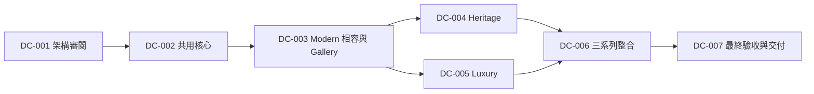

# XK Design Collection — DC-001～DC-007 工作包

日期：2026-11-26。規格版本：v1.0。依據：[架構](architecture.md)、[Design System](design-systems.md)。本文件定義未來可分別交給 Codex 的工作包；**只有 DC-001 在本次執行，其他均為 PENDING，沒有開發、合併或發布授權**。

## 1. 共通交付規則

- 開始每包前重新核對最新 main、AGENTS、README、公司規範、前置 PR 合併與來源版本。指定分支從已核准 main 建立，不整合未批准分支。
- 保留既有 stack、package-lock、一般／Pages 兩種建置、www 根網址、noindex/nofollow、Privacy／dev／Sitemap 保護。不加入 Backend、API、CMS、Analytics、資料庫、會員、依賴或 DNS／平台變更。
- 一個資料來源供三套 UI；相同服務、案例與試算輸入必須得到同一事實與金額。禁止風格倍率、虛構免費內含、客戶成果與正式報價承諾。
- 每包完成該範圍文件、實測、Diff、Commit、Push、以 main 為 base 的 PR；是否 merge／部署只依當次使用者明確指示。技術 CI 不能批准品牌、法律政策、價格或索引。
- 新風格尚未完成時不提供假入口；可見文字標示規劃中。每個新增公開路徑需同時完成內容、Metadata、導覽及 exact export／HTTP fixture，不能把安全規則全部延到 DC-006。
- Test report 在 PR 前完成，對應實際受測程式；後改程式依影響重驗，保留原 FAIL 與版本。遠端事件更新同一 PR Description，避免記錄自己 SHA 的循環提交。

## 2. 相依與階段



DC-004／DC-005 可平行設計；共用來源、registry、layout 及 fixtures 必須有單一 owner，發布清冊依實際核定順序更新。表中 33 頁是先完成一個新系列時的總數，不要求先合併 Heritage 才能做 Luxury。每包的 PR 均獨立審閱；前置工作未合併時停止依賴實作並回報。

## 3. DC-001 — 架構與設計規範

<a id="dc001"></a>

- 分支：`docs/design-collection-dc001`；建議 Commit：`docs(design): define XK Design Collection architecture`。
- 前置：最新公司及 Website 來源核對、現有 16 頁與 Quotation 已合併。
- 輸入：本次使用者要求、根 AGENTS／README／workflow、固定版本公司文件、既有 root layout／SEO／部署／資料與 Next.js 文件。
- 交付：三份規範、任務索引、來源／差異／風險、DC-001～007 分工、文件驗證報告；更新專案入口。
- 限定檔案：`docs/design-collection/`、`docs/task/dc001.md`、`docs/reports/dc001-architecture.md`／`docs/reports/dc001-verification.json`、README／AGENTS／task index／implementation notes 的必要文件段落。
- 排除：所有 runtime／public 資產／package／Next 設定／workflow 變更；不新增路由、不改正式首頁、不部署、不變更 DNS。
- 驗收：路由與 49 頁目標算式明確；Modern 保留、三 DS 獨立、共用資料、canonical／OG 例外、static params、404、切換／PII、CSS／print 風險可執行；所有提案與核准資料有界線；Markdown／連結／格式／Diff 通過。PR CI 與 artifact 確認純文件沒有污染網站資源。
- 實際狀態：依 [DC-001 驗證紀錄](../reports/dc001-architecture.md)；文件完成不表示其他六包完成。

## 4. DC-002 — 共用內容、路由與互動契約

<a id="dc002"></a>

- 分支：`feature/design-collection-core`；前置：DC-001 核准並合併。
- 範圍：唯讀內容 adapter、style／page key registry、href resolver 與 metadata adapter；共用 Contact／Quotation 行為介面；定義三套 DS 的語意 token 契約與 portal／print 隔離方案。
- 規劃新增：`src/config/design-collection.ts`、`src/lib/design-collection/`、必要共享型別／測試、獨立 design-collection fixture 與報告。現有價格／服務／案例仍是權威來源，不搬成三份資料。
- 修改限制：現有 UI 與 16 條 URL 不變；不提前輸出 Gallery 或新風格、不把 planned registry 當公開清冊。抽取行為只有必要時進行，保留原可觀察行為。
- 驗收：9 種內容 page key（含兩種作品詳頁）加獨立 collection key，共 10 種邏輯目的地；各 style 合法路徑可逆且無碰撞，未知 style／slug 拒絕；同內容 canonical 與 presentation URL 分開且 Modern 不變；Contact 草稿不持久化；Quotation 無重計、無倍率、未知非零；相同 IDs 得到同一計算。
- 測試：新增有獨立預期的 resolver／metadata／adapter／PII 及必要負向案例；跑共通六指令。原 16 頁功能與 metadata／錨點回歸、兩模式 PDF／跨頁 print 隔離只在實際受影響時重驗並記錄判定。
- 完成門檻：無新公開 URL、無新增業務事實或依賴，純核心提案經 PR 審核；報告記錄未動到的呈現與需要後續驗證的內容。

## 5. DC-003 — Modern 相容、技術根 Layout 與集合入口

<a id="dc003"></a>

- 分支：`feature/design-collection-modern`；前置：DC-002 合併。
- 範圍：將原 shell／routes 搬到 Modern group，技術 root 保留 metadata／font／JSON-LD；Modern facade 沿用既有 DS。新增 Gallery，只有 Modern 入口有效，其餘可為無連結規劃卡。
- 規劃修改：`src/app/layout.tsx`、原 route 實體位置、各 scope not-found、ModernFrame、Gallery、published directory／SEO／guard 內實際 source path；一般與 Pages 設定不變。
- 驗收：16 個原 URL／title／canonical／OG／錨點／表單與試算不變，沒有 route 碰撞或重導；每頁一個 h1、main、skip link 及 WebSite JSON-LD。全域未知及 known-page notFound 無雙 Header／Footer，草案／dev 仍被排除。新增 Gallery 後精確 17 頁。
- 視覺：固定同環境對 Modern Home／Services／Portfolio／Contact／Quotation 在 375／1440 比較搬移前後，無無法解釋的視覺差異；Gallery／directory 增量單獨標示。五寬驗所有 17 頁無橫溢。
- 功能：Contact 四欄驗證／預覽／手動複製 fallback、Quotation 服務／建置／加購／複雜度、ID 保存／PII 不落盤、A4 最壞案例兩模式重驗。
- 測試：六指令、17 頁 HTTP／links／assets／SEO／404、影響頁 axe 與鍵盤／手機／Reduced Motion。保留搬移前 baseline 與實際截圖，不能借用舊任務結果當本輪 PASS。

## 6. DC-004 — Heritage 完整設計系列

<a id="dc004"></a>

- 分支：`feature/design-collection-heritage`；前置：DC-003 合併，Heritage 新增 palette／外框／素材適用範圍完成品牌審閱。
- 範圍：獨立 HeritageFrame、token／recipes、七主頁及九作品詳頁的編輯式呈現，消費共用資料與核心；不變造品牌歷史或價格。
- 規劃新增：`src/design-systems/heritage/`、`src/components/design-collection/heritage/`、已知 style 的 route composition 與 approved 資產（若有）。共享 registry／SEO／directory／fixture 由單一 owner 整合。
- 驗收：16 個 Heritage 頁可直接開啟／reload 且同內容等價；Hero、服務、作品、合作／CTA 至少四項構圖差異，Header／Footer 獨立；不是 Modern 換紙色。未知 style／slug 真 404，無根路徑／相對圖 404。
- 測試：六指令；新 16 頁與既有頁必要回歸；五寬、keyboard／focus／disclosure、axe、Reduced Motion、跨 style 返回與 CSS 殘留、Contact／Quotation 相同行為、A4 與 PII reset；新增 palette 對每種實際表面量測對比。
- 畫面：Home 五寬、Services／Portfolio／Contact／Quotation 的 375／1440、新詳頁代表與 A4 真 PDF；逐張人工檢視，全部頁另有自動化版面／內容檢查。
- 清冊：此為第一個新系列時 33 頁；若 Luxury 已核准合併，則 49 頁。Gallery 只對已完成系列提供入口，不捏造其他系列狀態。

## 7. DC-005 — Luxury 完整設計系列

<a id="dc005"></a>

- 分支：`feature/design-collection-luxury`；前置：DC-003 合併，Luxury 新增 palette／外框／素材適用範圍完成品牌審閱。
- 範圍：獨立 LuxuryFrame、token／recipes、七主頁及九詳頁的精品式呈現；共用內容與核心，不新增「高級版」價格或客戶承諾。
- 規劃新增：`src/design-systems/luxury/`、`src/components/design-collection/luxury/` 與對應 route composition；共享整合限制同 DC-004。
- 驗收：與 DC-004 相同完整功能／內容／路徑門檻，另驗深色表面、反白 Logo、hover／focus／selected／disabled、autofill、錯誤訊息與真實圖片可讀性。不能以隱藏資訊換取極簡。
- 測試／截圖／PDF：依 DC-004 同一矩陣與證據標準。Heritage 已實作時驗 Luxury → Modern → Heritage 樣式還原；否則驗 Luxury ↔ Modern 及未完成風格提示，完整三向切換留 DC-006。無影片／輪播／游標套件或新增外部請求。
- 清冊：第一個新系列時 33 頁，兩新系列完成後 49 頁；實際核定路徑逐項記於 fixture。品牌與 A4 標準摘要不染金色。

## 8. DC-006 — 三系列切換、SEO 與展示整合

<a id="dc006"></a>

- 分支：`feature/design-collection-navigation-seo`；前置：DC-004、DC-005 已合併且完整頁清冊核定。
- 範圍：Gallery 比較、StyleSwitcher、三套 Header／Footer／CTA 完整接入同一 href resolver；補齊 Metadata／canonical 對照與發布清冊，既有各包已落實的安全規則不能延後才補。
- 驗收：49 頁可達，所有 Footer 分組列出全部已發布網址；切換同 page key／合法 slug／可用 anchor，沒有對應頁時文字明確、無假連結；目前項目可辨識，手機、鍵盤、focus 與 back／forward 正常。
- SEO：Modern 16 頁不變；Gallery self-canonical；32 展示頁 canonical 對 Modern 對應頁、OG 為本身系列 URL；全站 noindex/nofollow、無 hreflang、無未核准分享圖與 Sitemap。每頁唯一 WebSite JSON-LD，不產生三公司或假 schema。
- 個資：跨風格不透過 URL、cookie 或 storage 攜帶個人欄位；Quotation 只復原 IDs，Contact 草稿／Quotation 個人欄位確實清空並有可見提示，拒絕 storage／Clipboard 仍可操作。
- 測試：六指令、49 頁 HTTP／assets／links／SEO 精確比對；三方向切換與不同深度頁、新分頁、unknown 404；三系列共用功能、跨頁 print 與控制項 fixture 白名單。所有必要修正附失敗／重驗紀錄。

## 9. DC-007 — 完整驗收、維護文件與發布準備

<a id="dc007"></a>

- 分支：`test/design-collection-release`；前置：DC-006 合併。
- 範圍：全套內容等價／視覺差異／行為／accessibility／效能／兩模式靜態驗收，維護文件、已知問題與 rollback 步驟；只修本輪實際缺陷，不任意升級或擴功能。
- 五寬：320／375／768／1440／1920，49 頁×5＝245 個 layout cases／模式；普通與 Pages 分開，完整進入／reload／有效錨點及所有本機資源。
- 可及性：公開頁及實際開啟選單／disclosure 的 axe WCAG 2／2.1 A/AA，另按 WCAG 2.2 AA 適用條件人工檢查 focus 遮蔽、target size、200% browser zoom、320 reflow、文字間距與 Reduced Motion。真人讀屏至少逐系列完成首頁→服務→作品→聯絡／試算旅程，不能用 AX tree 代替。
- 標準摘要：三套最大 17 加購、40／60 字、面議／起價／年度費用，兩模式共至少 6 份實際 PDF；每份 1 頁 A4、文字／圖形在頁內、Logo 與兩 QR 可見並實際解碼。失敗先修，不以裁切／刪內容或未知當 0 通過。
- 內容：每個相同資料 ID／作品狀態／外鏈／價格來源／已選輸入，三套逐項等價；unknown／planned／draft／reference-only 保護不因版型遺失。
- 效能：固定工具、viewport、CPU／網路／cache 條件，每系列 Home 及最大風險頁至少 3 次冷樣本，另走暖 cache 互動；比較修改前後中位數／範圍，CLS≤0.1、lab LCP 目標≤2.5 s、lab TBT 目標≤200 ms。實測未達如實 FAIL 並處理；無 field 資料不宣稱 INP／CWV p75 通過，未測真機列明限制。
- 截圖：三首頁各五寬 15 張；三套 Services／Portfolio／Contact／Quotation 各 375／1440 共 24 張；Gallery 375／1440 兩張；每系列作品詳頁代表 375／1440 六張；6 份 PDF 及跨頁列印必要圖。基礎清單共 47 張網站圖，不含 PDF 渲染及修復對照，全部真實捕捉並人工檢視。
- 完成：所有 Required assertions 有真 exit／預期／實際／版本／證據；阻擋 FAIL 為 0，外部 BLOCKED 不冒稱完成。確認最終 PR head CI 與 artifact 資源。**本規格不預先授權 merge／deploy**；有當次授權後才驗 main CI、Pages deployment、正式網址／資源／互動，否則交付 PR 等待審閱。

## 10. 功能包的共通測試與證據

以下為 DC-002～DC-007 的未來執行要求，**不是 DC-001 已執行結果**。最終完成版本執行：

```sh
npm ci
npx tsc --noEmit
npm run lint
npm test
npm run build
npm run build:pages
```

一般 build／server 驗收完成並停止後，才跑 Pages build／static preview，避免同時覆寫 `.next/`。HTTP 共用入口仍為 `npm run test:smoke -- --base-url <實際preview網址> --output <新的暫存證據檔>`；route fixture 先按當階段核定清冊擴充。分配未占用的 loopback ports 並記錄，不假定舊 server 可重用。

每項測試須記錄 Test ID、項目、Command／Procedure、Environment、Expected、Actual、真 Exit Code（人工判讀則 N/A 並說明）、Status、Log／Screenshot／HTTP 等 Evidence 與 Notes。狀態只用 PENDING、PASS、FAIL、BLOCKED、N/A；N/A 附適用性原因，BLOCKED 附外部條件。

FAIL 不得改成 PASS。記錄原因、影響與修正，能修先修再重跑受影響案例，無法修列 Known Issues；阻擋 FAIL 存在時不得宣稱完整交付。不得跳過、降低標準或隱藏錯誤取得 PASS；缺程序完成／退出碼或缺 Required assertions 視為未完成，外部權限／環境阻擋記實際原因。

每包報告建議 `docs/reports/dc00N-implementation.md`，實際截圖在 `docs/screenshots/design-collection/dc00N/`；原始資料放暫存，只封存必要證據。文件需避免影響 Tailwind utility discovery，最終 CI artifact 與受測輸出需確認；不要把純文件文字變成網站新 CSS。Commit／PR／PR CI／人工審閱／授權合併／main CI／正式部署／公開實測各為獨立階段。
