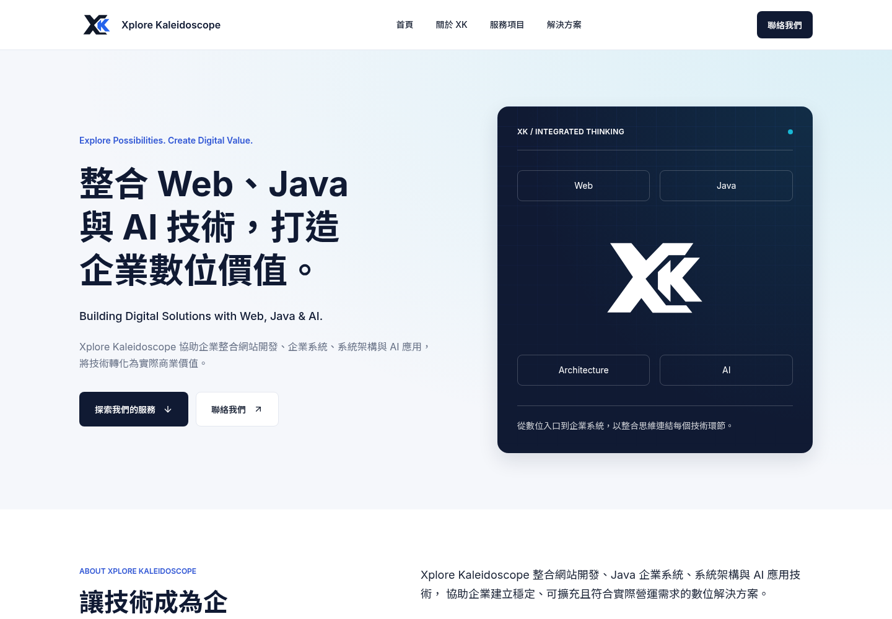
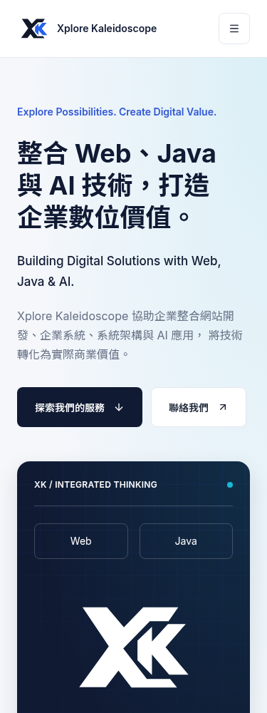

# Task 003 — XK 企業首頁實作

本次依 [Task 003 規格](../task/task003.md) 完成 Xplore Kaleidoscope 第一版企業首頁，延用已合併的 Next.js 架構與 XK Design System。品牌標語為 **Explore Possibilities. Create Digital Value.**，技術標語為 **Building Digital Solutions with Web, Java & AI.**。

## Repository 與前置檢查

| 項目 | 本次基準 |
| --- | --- |
| Website Repository | `xk2022/xk-website` |
| Base Branch / Commit | `main` / `6feb400996e45e0e9bc285425a99e014f5381057` |
| Feature Branch | `feature/website-homepage` |
| Task 002 前置條件 | 已確認合併成果為上述 main 的祖先，保留其元件與設定 |
| 文件 Repository | `xk2022/xplore-kaleidoscope`，僅供讀取 |
| 文件讀取版本 | `3996730176e4ad7237c66f541d61405f2667934e` |
| Commit / Pull Request | 待最終交付填入 |

閱讀 README、AGENTS、[歷史實作紀錄](implementation-notes.md)、[品牌設計系統](brand-design-system.md) 與目前可用的任務原稿。`docs/task/task001.md` 已不存在，原文位於 [task001-implementation-notes.md](task/task001-implementation-notes.md)，另有繁體中文版本；`task002.md` 是零位元組空檔，完整規格為 [task002.zh-TW.md](task/task002.zh-TW.md)。本次修正 README、AGENTS 及指南引用，保留實際任務原稿與歷史紀錄內容。

以下八個 Week 02 主題均已讀取，實際位置為 `doc/01_business-plan/week-02/`：

| 主題 | 實際文件 |
| --- | --- |
| 品牌識別 | `01_brand-identity_品牌視覺識別規範.md` |
| Logo | `02_logo-guidelines_XK Logo 設計與使用規範.md` |
| 色彩 | `03_color-palette_品牌色彩系統規範.md` |
| 字體 | `04_typography_品牌字體與排版規範.md` |
| 網站地圖 | `05_website-sitemap_ 官方網站資訊架構與網站地圖.md` |
| 首頁文案 | `06_homepage-copywriting_官方網站首頁文案規劃.md` |
| 架構 | `08_website-architecture_官方網站 Next.js 技術架構設計.md` |
| MVP | `09_website-mvp_官方網站 MVP 開發規格.md` |

要求的 Week 02 主題皆存在。既有規劃中的 `frontend-development-guide.md`、`deployment-guide.md`、`website-launch-checklist.md` 仍未提供。另檢查了包含 Domain／Hosting 文件在內的全部 31 份 Markdown，以區分規劃中的聯絡資訊與已確認管道；未寫入文件 Repository。

## 範圍與衝突處理

本次優先保留已合併的 Task 001／002 程式碼及元件 API，再採用 Task 003 明確要求。README 舊里程碑把 Task 003 寫為 Header／Footer、Task 004 寫為 Homepage，但目前 Task 003 明確要求企業首頁，因此此次同時完成首頁與共用 Layout。

保留 Next.js、React、Strict TypeScript、Tailwind CSS 4、shadcn/ui、Lucide、App Router、`src/` 及 `@/*`。沒有重新初始化、升降級套件、建立 Backend 或完整內頁；`package.json` 僅為 Pages 增加建置 Script，Dependencies 與 lockfile 保持原版本。

使用者在 Task 003 另選擇 **GitHub Actions → GitHub Pages 靜態部署**，優先於舊任務的 Vercel 目標。一般 `npm run build` 仍保留 Vercel 相容模式；Pages 使用獨立 `npm run build:pages`，不變更 DNS、Custom Domain 或已確認的品牌 Canonical。操作細節見 [Pages 部署指南](github-pages-deployment.md)。

舊文案的額外 Portfolio、Insights、Process、產品功能與聯絡 API 不納入本次首頁。舊規劃中的色票、較長服務路由及 monorepo 位置不取代目前已合併的網站設定。

## 首頁資訊架構

| 順序 | 區塊／元件 | 內容與行為 |
| --- | --- | --- |
| Layout | `SiteHeader` | 原稿 Logo、品牌名稱、桌面導覽、聯絡 CTA 與手機選單 |
| 1 | `HomeHero` | 中文 H1、英文品牌與技術標語、真實服務／聯絡錨點、品牌幾何視覺 |
| 2 | `HomeIntroduction` | 品牌定位、技術品質、商業價值與長期維護 |
| 3 | `HomeServices` | R01–R05 五項服務，非互動內容 Card 與全部服務摘要 |
| 4 | `HomeTechnologies` | Frontend、Backend、Database & Integration、AI & Automation、Infrastructure 五組能力 |
| 5 | `HomeWhyXk` | 整合能力、商業需求、可擴充架構、長期支援四項價值 |
| 6 | `HomeSolutions` | 數位形象、系統現代化、AI 自動化三個方向，連至真實服務錨點 |
| 7 | `HomeContactCta` | 聯絡資訊入口；未確認管道時顯示待確認，不建立假提交 |
| Layout | `SiteFooter` | 品牌與標語、導覽、服務錨點、未公開頁面狀態與程式產生年份 |

七個首頁區塊由 `src/app/page.tsx` 組合。重複內容集中於 `src/config/homepage.ts`；一般品牌資料沿用 `siteConfig`，導覽集中於 `navigation.ts`，可公開的聯絡管道獨立放在 `contact.ts`。

技術分類中的 Java、Spring Boot、資料庫、Docker 等描述創辦人與 XK 的技術服務能力，不表示這些系統已安裝或運行在官網。沒有加入認證、合作夥伴標章、虛構公司數據或未完成產品的商用宣稱。

## 導覽與聯絡資訊

首頁使用 `/`、`/#about`、`/#services`、`/#solutions`、`/#contact` 等實際目的地。Footer 的服務分類連到 `/#service-{anchor}`；卡片內有對應 ID。`/about`、`/services` 及其他內頁仍列於規劃設定，不變成失效連結。Portfolio 與 Privacy Policy 以規劃／待建立文字呈現。

Hero 的服務 CTA 原規格建議 `/services`，目前未實作該頁，因此改用有效的 `/#services`。聯絡 CTA 同理使用 `/#contact`，不暗示已存在表單頁面。

搜尋文件後未找到已確認的公開 Email 或 LinkedIn 公司／品牌頁。`contact@xplorekaleidoscope.com` 出現在「建議電子郵件」及設定範例；其他信箱也是規劃，LinkedIn 只有渠道描述或泛用首頁連結。這些資訊不能直接公開為正式聯絡方式。

`verifiedContactChannels` 目前為空陣列。聯絡區塊保留品牌 CTA 視覺、顯示「正式聯絡方式待確認」，並提供可使用的服務瀏覽連結。沒有假表單、無效 `mailto:` 或偽裝可用的停用連結。待使用者確認可公開管道後，才更新集中設定並重新驗收對應入口。

Footer 年份使用目前日期運算，沒有寫死數字；Pages 靜態產物在建置時確定年份，後續重新建置時更新。

## Design System、響應式與可及性

沿用 [品牌設計系統](brand-design-system.md) 的八個 UI 色彩、九個 Typography Utilities、Container、Section、Button、Card、XkLogo 與 BrandPattern。`--muted` 仍為次要文字，`bg-muted` 仍映射 Surface，沒有重建另一套排版或間距系統。

Logo 仍使用兩個原始 XK 路徑、18 個字標路徑與既有 Transform，來源 SVG 未修改。保留提供素材的 Logo 專用色彩與 **Provisional（暫定版本）** 狀態，不重新繪製，也不宣稱最終品牌核准。Header／Footer 使用圖形搭配可讀品牌文字；深色 Footer 使用白色版本。

桌面 Header 與 Footer 維持 Server Components。唯一新增的 Client Component 為 `MobileNavigation`：原生 Button 開關、可辨識名稱、`aria-expanded`／`aria-controls`、Escape 關閉並回復焦點、點擊連結／外部及切換桌面寬度後關閉。選單為非模態展開式導覽，不鎖住整頁操作；既有設計系統按鈕 Demo 維持原 Client Component。

響應式沿用 Mobile First。服務卡片為手機一欄、平板兩欄、桌面三欄；Header、Footer、CTA 與技術分類依現有 Container／Tailwind 斷點調整。圖樣保持裝飾性、`aria-hidden`、靜態且不接收操作；沿用減少動態偏好與可見 Focus 規則。

實際驗收需涵蓋 320、375、768、1440、1920px，確認沒有溢出、重疊、不可見焦點、失效導覽或 JavaScript 錯誤，並檢查 WCAG 2.1 AA、鍵盤與深色 Footer 對比。

## SEO 與發布保護

首頁使用獨立 Title、中文 Description、Canonical、Open Graph Title／Description／URL、`zh-TW` 與語意化標題層級。Canonical 沿用 `https://xplorekaleidoscope.com`；不捏造 Open Graph Image 路徑。

保留建置階段 `noindex, nofollow`。完成首頁與產生 Pages artifact 不等於已決定開放搜尋索引；正式上線前需獨立確認。沒有新增追蹤 Script、Analytics、Cookie 系統或動畫套件。

設計系統開發頁不加入正式導覽。一般 Next.js production 仍預設 404，明確旗標才可驗收；Pages 靜態版本直接排除該路由及頁面 payload。

## Actions 與交付物

本次新增 quality → pages-build → deploy 工作流程。PR 執行 `npm ci`、TypeScript、ESLint、一般 Build、Pages Build 並上傳 artifact；只有 `main` 推送或手動選擇 `main` 才發布 Pages，不自動合併。

公開 Pages 站曾由舊 Jekyll 工作流程發布，須確認 Settings → Pages → Source 已選 GitHub Actions。現有網址可開啟不證明此版本已部署，發布結果以實際 Actions run、deploy URL 與瀏覽器檢查為準。

主要交付物包括首頁及共用 Layout 原始碼、集中內容設定、原稿相容元件、一般 `.next/` 診斷 artifact、Pages `out/` artifact、實作與部署文件、實際驗收截圖及 PR。沒有把 `.next/` 或 `out/` 提交至 Git。

## 檔案異動清單

以下清單已依本次 Git diff 核對；套件版本、lockfile、Logo 原始資料及 Design Tokens 未變更。

| 狀態 | 檔案 | 用途 |
| --- | --- | --- |
| 新增 | `docs/screenshots/task003-1440.png`、`task003-375.png` | 以 Pages 靜態產物擷取的桌面／手機首屏截圖 |
| 新增 | `.github/workflows/ci.yml` | 品質檢查、兩種 Build、Pages 發布 |
| 新增 | `scripts/build-github-pages.mjs` | 靜態匯出與產物檢查 |
| 新增 | `src/components/layout/mobile-navigation.tsx` | 可操作的手機導覽 |
| 新增 | `src/components/sections/home-hero.tsx` | 首頁 Hero |
| 新增 | `src/components/sections/home-introduction.tsx` | 品牌介紹 |
| 新增 | `src/components/sections/home-services.tsx` | 五項服務 |
| 新增 | `src/components/sections/home-technologies.tsx` | 分類技術能力 |
| 新增 | `src/components/sections/home-why-xk.tsx` | 四項價值 |
| 新增 | `src/components/sections/home-solutions.tsx` | 三個解決方案方向 |
| 新增 | `src/components/sections/home-contact-cta.tsx` | 待確認／已確認聯絡入口 |
| 新增 | `src/components/sections/section-heading.tsx` | 共用區塊標題 |
| 新增 | `src/config/homepage.ts` | 集中首頁內容 |
| 新增 | `src/config/contact.ts` | 僅公開已確認聯絡管道 |
| 新增 | `docs/homepage-implementation.md` | 本次實作與驗收紀錄 |
| 新增 | `docs/github-pages-deployment.md` | Pages 工作流程與設定方式 |
| 修改 | `src/app/page.tsx` | 首頁組合與 Metadata |
| 修改 | `src/components/layout/site-header.tsx` | 正式桌面 Header 與手機導覽入口 |
| 修改 | `src/components/layout/site-footer.tsx` | 正式 Footer |
| 修改 | `src/components/sections/home-intro.tsx` | 保留既有 HomeIntro 匯入相容性 |
| 修改 | `src/config/navigation.ts` | 真實首頁錨點與規劃路由分開 |
| 修改 | `src/app/dev/design-system/page.tsx` | Pages 匯出先拒絕，保留一般開發驗收 |
| 修改 | `next.config.ts` | 條件式 Pages export 設定 |
| 修改 | `package.json` | 加入 `build:pages`，不調整套件版本 |
| 修改 | `README.md` | 目前里程碑、操作與部署指引 |
| 修改 | `AGENTS.md` | 可用規格引用、Task 003 分支、使用者確認的 Pages 方向 |
| 修改 | `docs/98_decisions/implementation-notes.md` | 保留歷史並追加 Task 003 |
| 修改 | `docs/brand-design-system.md` | 僅修正更名／空白任務文件的引用 |

## 驗收與交付紀錄

| 項目 | 實際結果 |
| --- | --- |
| `npm install`／lockfile 未意外變更 | 通過；npm install exit0，lockfile 無差異 |
| `npx tsc --noEmit` | 通過，exit0 |
| `npm run lint` | 通過，exit0，零警告 |
| `npm run build` | 通過，exit0；首頁靜態預先產生，開發驗收頁依請求處理 |
| `npm run build:pages` | 通過，exit0；GitHub Pages 靜態產物 out/ 已驗證 |
| 一般 Next.js 本機首頁與開發頁保護 | 通過；一般 production 首頁200、開發驗收頁404；npm run dev 驗收頁200 |
| Pages artifact 路徑、404、`.nojekyll`、無開發路由 | 通過；/xk-website/ 資源與導覽前綴正確，404.html／.nojekyll 存在，公開開發路由404且頁面 payload 未匯出 |
| Desktop／Mobile／五種 Viewport | 320／375／768／1440／1920px 全部通過，無水平溢出；服務網格1／2／3欄正常 |
| Header、Mobile Navigation、Footer、全部有效連結 | 通過；所有實際連結與錨點皆可用並保留 Pages Base Path；選單開啟、連結後關閉、外部點擊與桌面切換皆正常 |
| Accessibility、Focus、Escape、色彩對比、Reduced Motion | 通過；五種寬度及展開選單未檢出 axe WCAG 2/2.1 A/AA 違規，Escape 還原焦點，skip link 正常，reduced-motion 過渡為0s |
| JavaScript Runtime Errors | 無；靜態網站的 JS、CSS、字體亦無載入失敗 |
| 截圖與人工視覺檢查 | 已輸出並檢視桌面／手機首頁、手機導覽、服務、技術、解決方案與聯絡區塊截圖 |
| Actions quality／Pages build | Workflow 已通過 actionlint 1.7.12；遠端執行結果以 PR Checks 與交付報告中的實際 run 為準 |
| Pages Source 設定／main 部署 | 檢查時仍是 legacy Jekyll。瀏覽器未登入且 API 更新回覆403；設定未變更，建議管理者選擇 GitHub Actions，避免舊發布流程競爭。本次不合併或發布 main |
| Commit／PR／工作目錄狀態 | 功能分支 feature/website-homepage；提交與 PR 識別碼見交付報告，等待審核，不自動合併 |

此表只記錄 Task 003 本次實際結果，不沿用前兩次任務的通過狀態。自動化掃描通過也不取代完整的輔助科技人工檢查。

## 尚未完成事項

已確認可公開的聯絡管道仍待使用者提供；內頁 `/about`、`/services`、服務明細、`/solutions`、`/portfolio`、`/contact`、`/privacy` 尚未實作。最終 Logo 核准、Open Graph Image、正式網域連接、搜尋索引開放與其他後續功能須另依任務執行。沒有建立 Backend 的必要，也沒有在本次引入。

Pages 實際來源設定與發布情況，以部署指南及最終 Actions 結果為準。現有 ESLint 9 與上游 Next.js plugins 的相容性限制維持既有紀錄，本次沒有為此升降級套件。

## PR 視覺證據

以下截圖直接由本次 GitHub Pages 靜態產物擷取，非示意圖。完整頁面與各區塊截圖另隨任務回報提供。

